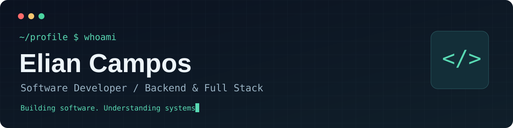
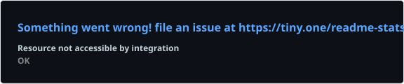

 

**Software Developer · Backend & Full Stack Engineering**

*Building software. Understanding systems.*

### `$ whoami`

I'm a software developer working across backend services, web applications, APIs, and cloud infrastructure. I care about building reliable software, understanding trade-offs, and learning what happens beneath the abstractions.

### `$ stack --current`

**Backend** · TypeScript · Node.js · NestJS · Java · Spring Boot  
**Frontend** · React · Next.js · Angular  
**Data & Cloud** · PostgreSQL · MongoDB · AWS

### `$ explore --beyond-work`

- **Systems programming:** C, C++, computer architecture, and operating systems
- **Computer graphics:** Vulkan and rendering fundamentals
- **Emulation:** building a CHIP-8 emulator and exploring low-level execution
- **Engineering:** distributed systems, architecture, performance, and infrastructure

### `$ github --insights`

  
  

Stats and language breakdown are generated from GitHub data by third-party services. Language percentages reflect repository code, not proficiency; commit counts and private activity may be incomplete. The stats card also displays stars earned.

### `$ connect`

[GitHub](https://github.com/lyandeveloper) · [Email](mailto:tutors3d@gmail.com)

---

Curiosity is a feature, not a distraction.

